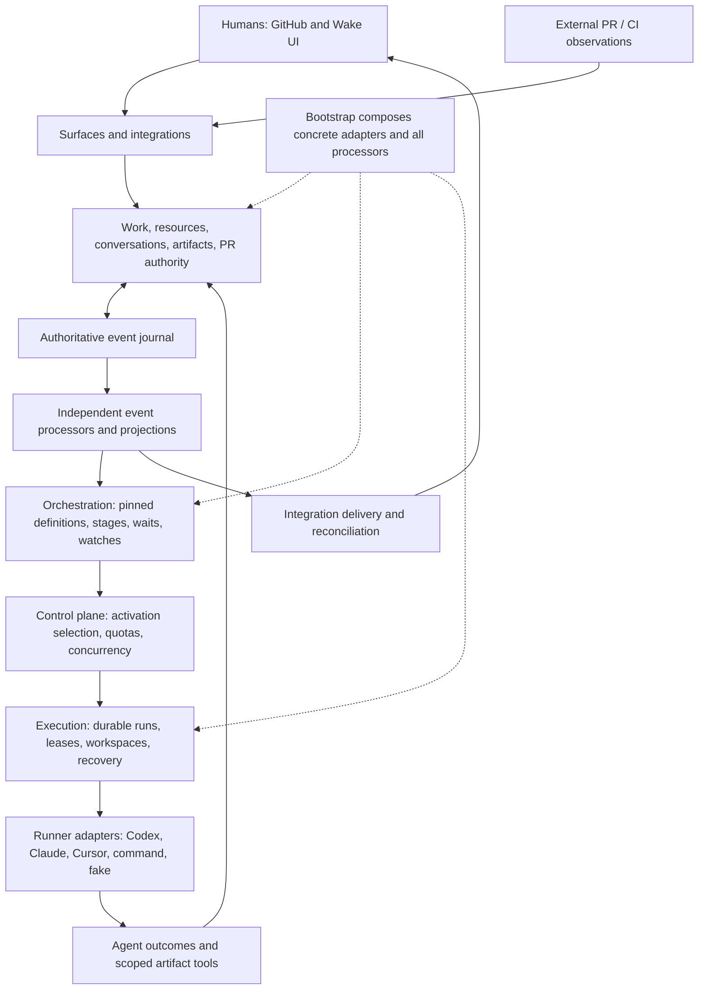

# Wake architecture and product recommendation review

Date: 10 October 2026. Reviewed revision: `09d6ef92a9b847d6495e06095f0042fc78a23e74`.

This assessment compares `wake-v2-architecture-reassessment.md` and `wake-agent-execution-runtime-managed-sessions.md` with the implementation. During the review, local `main` and `analyze-wake-architecture` were fast-forwarded to fetched `origin/main`, including #858 (durable work-item artifacts), #859 (extension-needed indicators), and #857 (admission contention repair).

Findings describe code and inspected coverage. Proposed benefits and effort ranges are engineering judgments, not measured production improvements. No runtime changes or architectural spikes were implemented as part of this report.

## Recommendation

Preserve Wake's infrastructure and evolve its software-delivery domain. Wake is already substantially aligned with **agent-managed execution, runtime-managed sessions, Wake-managed work**. The session paper is mostly a refinement of existing mechanisms. The graph-first paper proposes a larger change to what Wake models and governs.

**First recommended approach: refine the prompts and process using the existing runtime.** Audit the deployed refinement/review configuration and representative stalled runs, align their definition of an implementable plan, and trial an optional interview for tickets missing consequential product intent. Gather known necessary questions in batches, let agents investigate and decide ordinary implementation details, and make review distinguish concrete blockers from optional preferences. Detailed tickets should bypass the interview. Evaluate this before introducing a new supervisor, work graph or execution framework.

The subsequent direction, informed by the user's observed behavior, is a combination of:

1. Bounded agent judgment under incomplete specifications, with explicit assumptions and questions only where human input is genuinely required.
2. Adaptive review recovery, independently governed child WorkItems and dependencies, progressing toward stacked changes.
3. Deterministic command authority and a bounded supervisor for exceptional replanning.
4. Artifact-backed handoff, batched decision requests and structured review findings as supporting mechanisms.

Treat changing workflows into mutable graph recipes as a substantial domain redesign. It can be migrated incrementally while retaining the event journal, storage, integration delivery, agent adapters, and much of execution. A wholesale rebuild is not justified by the evidence.

Evaluate LangGraph only against a concrete deletion target. AG-UI is an optional interaction adapter; CopilotKit is an optional component source. None supplies the missing work semantics.

## Observed product problem: progress under uncertainty and workflow rigidity

The user reports repeated clarification when objectives are underspecified, agents sometimes seeking answers instead of making reasonable implementation decisions, review rounds exhausting, and a need for subtasks and stacked PRs. The user has not yet used the new artifacts. Therefore artifact benefits are an architectural opportunity, not demonstrated evidence that #858 has already solved these problems.

This changes the investment priority. The central problem is not storing or rendering questions. It is deciding when work can proceed, how to make uncertainty explicit, and how to adapt when review discovers a different problem than the current correction loop assumes.

| Observed problem                                      | Proposed behavioral change                                                                                                                                                                                                                             | What it enables/improves                                                                                                 | Scope                                                                                        |
| ----------------------------------------------------- | ------------------------------------------------------------------------------------------------------------------------------------------------------------------------------------------------------------------------------------------------------ | ------------------------------------------------------------------------------------------------------------------------ | -------------------------------------------------------------------------------------------- |
| Underspecified work produces excessive back-and-forth | Distinguish human decisions from agent-owned implementation choices and uncertainties that can be investigated. Gather necessary questions in a batch; document reasonable assumptions and proceed with authorized work where answers are not required | Less interruption and faster progress without silently redefining the objective                                          | Bounded assignment/prompt/outcome policy change; artifacts can hold assumptions and evidence |
| Agent asks instead of finding a solution              | Give the assignment explicit decision latitude and require investigation/recommendations before escalation, within existing budgets                                                                                                                    | More autonomous problem solving and better questions when human judgment is needed                                       | Incremental first; measure behavior rather than assuming prompt wording guarantees it        |
| Review budget exhausts                                | Classify unresolved findings and route to targeted correction, investigation, scope clarification, decomposition or human decision; budget exhaustion becomes an explicit escalation outcome with a proposed next action                               | Preserve work and address the cause of stalled reviews instead of repeating the same loop or merely increasing its limit | Incremental recovery policy first; independent corrective work needs graph semantics         |
| Workflow cannot accommodate discovered work           | Permit policy-checked creation of independently governed children and dependencies, preserving recipe provenance                                                                                                                                       | Adapt the plan without editing every possible exception into stage transitions                                           | Substantial domain extension                                                                 |
| Related changes are too large or sequential           | Add revision-qualified work/change dependencies and coordinate two stacked PRs through existing Git/GitHub mechanics                                                                                                                                   | Smaller changes, clearer review scope, and useful downstream progress before upstream merge where policy permits         | Substantial delivery-domain extension; do not start with a complete stacking engine          |

An unanswered question should block only work that actually requires the answer. Some uncertainty can be resolved through investigation, some through an explicit reversible assumption, and some needs a human decision. The agent should propose that classification; Wake should enforce the resulting authority and dependency effects. This should not become a rigid mandatory discovery questionnaire before every implementation.

For review recovery, preserve separate meanings: provider retries, implementation correction, and changes to the work plan. Existing retry and watch budgets are valuable safeguards, but exhaustion alone does not identify the right next action. A bounded supervisor can inspect unresolved findings and propose a permitted recovery route. It should not receive permission to bypass review or reset counters indefinitely.

The first practical experiment is prompt and process refinement: compare the current refinement/review loop with aligned approval criteria, explicit agent decision latitude, and an optional batched interview. Use existing artifacts for shared plans and assumptions where available. Introduce typed recovery recommendations only if that experiment leaves unresolved failure modes. Then prove independent child work and a two-PR stack where decomposition is needed.

## Process-first experiment: optional interview and aligned plan review

The user's more specific account is that refinement proposes a complete design, plan review discovers further gaps/questions, refinement expands the design, and another review can repeat the cycle until its budget exhausts. This suggests testing the process contract before attributing the problem to the architecture.

The repository provides concrete support for that possibility:

- `prompts/refine.md:29` distinguishes requirement ambiguity from implementation choices. It tells refinement to investigate module/event/pattern choices, record its decisions as assumptions and block only when the ticket's intent cannot be determined from the repository.
- `prompts/plan-review.md:24` checks unanswered questions and load-bearing assumptions. Its wider brief also checks architectural direction, operator judgment and whether obvious better solutions were considered (`:26-28`). It does not clearly separate required corrections from optional alternatives, or require each rejection to identify a concrete violated acceptance condition.
- The generated refinement scaffold requires every choice affecting externally visible or persisted behavior to have been made (`src/bootstrap/initialise.ts:148`). That can be interpreted as a more exhaustive specification standard than a bounded implementable plan needs.
- The generated default workflows do not include plan review; it is a configurable workflow/watch arrangement. The prompt templates and scaffolding are evidence of available behavior, not proof of which exact prompts and routes are active in the user's Wake home. Verify deployed configuration and failed-run transcripts before claiming a root cause.

A mismatch between permitted refinement assumptions and reviewer approval criteria is a plausible contributor, not yet a demonstrated cause. An early interview may reveal missing product intent, but it cannot eliminate unknowns discovered through code inspection. Reviewer-generated design alternatives and preference changes require aligned review policy, not more initial questions.

### Candidate process

```text
Assess ticket and repository context
    -> sufficient intent/specification: proceed to refinement/plan
    -> missing consequential intent: interview in batches
    -> technical uncertainty: bounded investigation
Plan: acceptance criteria, decisions, assumptions and deferred details
Review: assess the same agreed criteria and exact plan revision
    -> approve
    -> concrete correction
    -> newly discovered human decision: targeted interview
    -> substantial newly discovered work: propose investigation/decomposition
Implement and verify
```

The interview should establish desired outcome, essential constraints and observable acceptance criteria. It should gather all currently discoverable consequential questions in a batch and provide recommendations. It should not require a human to choose every implementation detail, expand into an exhaustive design session, or block work unrelated to an unanswered item. Detailed tickets should bypass it; idea-level tickets should receive it only to the extent needed.

Plan review should respect explicit agent decision latitude and prior authoritative answers. Findings should distinguish a requirement/acceptance gap, a demonstrable technical defect, new information, and an optional preference. A rejection should explain the concrete failure and needed correction. A preference for an alternative design should not automatically reopen product discovery. Review can still identify serious missed concerns; aligned criteria do not mean lowering the gate.

Use artifacts to hold the reviewed plan, assumptions and interview answers, with exact revision references so all participants share the same material. The optional process can initially be expressed through configured activities, existing waits and named workflow variants/selectors. A tag-selected idea/spec workflow already fits selection capabilities (`docs/workflows.md:318`). Automatically assessing ticket sufficiency and routing appropriately still needs a designed contract and tests; it is not achieved by adding a tag alone.

This is a bounded process/prompt/configuration experiment, not a prerequisite for rebuilding orchestration. Compare it against current refinement/review on representative tasks before investing in a general supervisor or mutable graph. Subtasks and stacked PRs remain separate larger capabilities for work that genuinely requires decomposition.

## Evidence strength and what remains a hypothesis

The recommendations have different evidential foundations. Repository inspection establishes which mechanisms exist and which semantics are missing. The user's experience establishes observed symptoms. Neither by itself demonstrates the cause of a failed review trajectory or the effectiveness of a proposed remedy. No Wake run-history study or controlled behavioral evaluation was performed for this report.

| Recommendation                                                                    | External grounding                                                                                                                                                                                                                                                                                                                                               | Confidence and limits                                                                                                                                                                       |
| --------------------------------------------------------------------------------- | ---------------------------------------------------------------------------------------------------------------------------------------------------------------------------------------------------------------------------------------------------------------------------------------------------------------------------------------------------------------- | ------------------------------------------------------------------------------------------------------------------------------------------------------------------------------------------- |
| Reasonable defaults, explicit assumptions and selective questions                 | GitHub Spec Kit's specification command tells the agent to infer reasonable defaults, document assumptions and reserve clarification for consequential choices without a reasonable default. [Actual command template](https://github.com/github/spec-kit/blob/main/templates/commands/specify.md)                                                               | Strong implementation precedent. Does not prove that prompt changes alone will reliably calibrate Wake's agents                                                                             |
| Batch known necessary questions                                                   | The same specification command presents its clarification questions together. Spec Kit's dedicated clarification command instead asks sequentially. [Specification command](https://github.com/github/spec-kit/blob/main/templates/commands/specify.md), [clarification command](https://github.com/github/spec-kit/blob/main/templates/commands/clarify.md)     | Supported product pattern and explicit user preference, not a universal empirically superior interaction strategy. Sequential follow-up can be useful when answers expose new uncertainties |
| Select questions by their value and stop redundant questioning                    | Structured Uncertainty guided Clarification reports improved coverage with fewer questions on a tool-calling ambiguity benchmark. Ask or Assume evaluates uncertainty-aware clarification on an underspecified SWE-bench Verified variant. [ACL paper](https://aclanthology.org/2026.findings-acl.2028/), [coding-agent paper](https://arxiv.org/abs/2603.26233) | Empirical support for selective clarification. Different scaffolds/benchmarks; no basis for transferring their numerical gains to Wake or claiming that asking less always helps            |
| Artifact-backed incremental handoff                                               | Anthropic describes an experimentally developed long-running coding harness using incremental work, progress files and Git history across sessions. [Engineering account](https://www.anthropic.com/engineering/effective-harnesses-for-long-running-agents)                                                                                                     | Good closely related engineering evidence. It does not validate Wake's specific staged-publication/access rules or prove that artifacts fix review rigidity                                 |
| Durable dependencies and independent tasks                                        | Beads implements dependency-aware ready work and hierarchy. Anthropic's orchestrator-worker pattern decomposes tasks whose subtasks cannot all be known beforehand. [Beads](https://github.com/gastownhall/beads), [agent patterns](https://www.anthropic.com/engineering/building-effective-agents)                                                             | Strong representational precedent. Throughput benefits depend on separable work; more agents or finer decomposition are not automatically better                                            |
| Stacked PRs                                                                       | GitHub documents discrete dependent changes, continued downstream development before upstream merge, stack review and branch mechanics. [Stacked PRs](https://docs.github.com/en/pull-requests/get-started/about-stacked-prs)                                                                                                                                    | Strong capability precedent. Native support is currently public preview; Wake-specific review invalidation and automation still need proof                                                  |
| Route stalled review to correction, investigation, clarification or decomposition | Routing and evaluator-optimizer patterns are established; evaluator loops are recommended where evaluation criteria are clear and refinement provides measurable value. [Anthropic patterns](https://www.anthropic.com/engineering/building-effective-agents)                                                                                                    | Medium confidence as a design hypothesis. The exact taxonomy, supervisor intervention and budget-exhaustion recovery have not been validated on Wake traces                                 |
| Replace orchestration with LangGraph                                              | A library offers relevant execution capabilities                                                                                                                                                                                                                                                                                                                 | Low confidence in net benefit until a parity/deletion spike. Existing capability is not evidence that replacement improves Wake                                                             |

Research strengthens the case for distinguishing specification uncertainty from the agent's own uncertainty. It does not support indiscriminately telling agents to ask fewer questions. Reducing avoidable questions while preserving necessary clarification is the objective. Likewise, the user's batching preference should be implemented without pretending that batch interaction is optimal for every dependency between answers.

The inference behind adaptive review recovery is that repeating implementation cannot resolve every kind of finding. That is reasonable, but competing explanations include poor prompts, incorrect acceptance criteria, stale review evidence, actual hard defects, missing context, or specific workflow bugs. Recent Wake fixes to watch gates and clarification resumption underline the need to distinguish implementation defects from architectural limitations.

### Evaluation before committing to the larger redesign

Use a small representative set of historical or reproducible tasks, including underspecified work and exhausted review trajectories. Record each failure's cause and compare:

1. Current Wake behavior.
2. Existing runtime plus clearer decision latitude, artifact-backed context and batched necessary clarification.
3. The same setup plus structured findings and bounded recovery routing.
4. A two-child/two-PR graph slice for tasks that actually benefit from decomposition.

Assess acceptance correctness alongside completion rate, avoidable human interruptions, rework caused by incorrect assumptions, review exhaustion, recovery effort and total runtime/token use. Do not count fewer questions or fewer review rounds as success if incorrect work ships. Start with the cheaper behavioral/context change; adopt graph mutation or supervisor machinery only where it provides additional demonstrated value.

This is evidence-informed prioritization, not a claim that a particular improvement is proven to have a high probability of success in Wake. The report's delivery estimates are also provisional planning judgments.

## What Wake is already strong at

| Existing strength                                             | What it already enables                                                                                                  | Relevant evidence                                                                                                               |
| ------------------------------------------------------------- | ------------------------------------------------------------------------------------------------------------------------ | ------------------------------------------------------------------------------------------------------------------------------- |
| Wake-owned work identity, separate from runs                  | Work persists across agent invocations and can originate outside GitHub                                                  | `src/work/contracts/views.ts:13`; `src/control-plane/application/schedule-service.ts:52`                                        |
| Authoritative append-only journal and rebuildable projections | Auditable state, replay, deterministic services, replacement of presentation without moving authority                    | `packages/eventing/MODULE.md`; `packages/eventing-filesystem/MODULE.md`                                                         |
| Independent supervised event processors                       | Internal progression without keeping an agent alive or waiting for the next external poll                                | `packages/eventing/src/runtime/event-processor-host.ts:62`; `src/bootstrap/event-processor-runtime.ts:50`                       |
| Ordered runner pools and durable quota exclusion              | Another configured provider can take over after quota exhaustion; quota failure does not consume normal workflow retries | `src/execution/infrastructure/runners/registry.ts`; `src/orchestration/domain/runner-quota-retry-policy.ts:35`                  |
| Durable session resumption                                    | Returning to an implementation stage can continue its previous compatible session                                        | `src/execution/application/execution-service.ts:730`; `:819`                                                                    |
| Content-addressed workflow definitions                        | Active instances retain the compiled definition they started with despite later configuration changes                    | `src/orchestration/application/workflow-definition-registry.ts:18`; `:97`; `src/orchestration/application/start-workflow.ts:47` |
| Canonical conversations with external representations         | Discussion and revision history survive changes to the interaction surface                                               | `src/conversations/contracts/views.ts:33`; `:48`                                                                                |
| Revision-qualified PR review and merge authority              | A previous approval cannot automatically authorize a changed PR head; checks, consent and file policy can govern merge   | `src/activities/pr/policy.ts:17`; `:136`; `src/activities/pr/projection.ts:52`                                                  |
| Validated external artifact claims and durable delivery       | Provider effects are mediated, correlated and reconciled rather than inferred solely from agent prose                    | `src/integrations/application/artifact-registration-reactor.ts:93`; `:170`; `src/bootstrap/integration-runtime.ts`              |
| New durable artifact revisions and scoped MCP tools           | Agents can produce durable files outside Git, and later authorized activities can discover/read published revisions      | `src/artifacts/contracts/views.ts:4`; `src/artifacts/application/artifact-service.ts:151`; `src/bootstrap/artifact-mcp.ts:19`   |

These strengths change the interpretation of the papers. Provider failover, workflow versioning, session continuity, external-event progression, and canonical human discussion are not greenfield features.

## Current architecture map



| Boundary          | Current responsibility                                                                                     | Recomposition assessment                                                      |
| ----------------- | ---------------------------------------------------------------------------------------------------------- | ----------------------------------------------------------------------------- |
| `kernel`          | Identifiers, relations and shared contracts                                                                | Retain                                                                        |
| Eventing packages | Journal ports, processors, checkpoints, projections, processor state; filesystem adapters separately       | Already extracted and relatively independent                                  |
| `work`            | Objective, lifecycle, consent, freeze/delete and descriptive links                                         | Suitable home for graph semantics, currently too small to provide them        |
| `resources`       | External identity, capability and work correlation                                                         | Retain for PRs/issues and provider identity                                   |
| `artifacts`       | Wake-owned bytes, revisions, scoped visibility and MCP tool semantics                                      | Retain and extend; distinct from external resources                           |
| `conversations`   | Canonical multichannel discussion and representations                                                      | Retain; discussion needs links to structured questions/decisions              |
| `activities`      | Typed execution capabilities and specialist PR review/merge policy                                         | Retain execution boundary; separate general judgment from activity completion |
| `orchestration`   | Compiler/interpreter, pinned definitions, activations, waits, watches, bounded retries                     | Principal domain migration area; potential partial runtime replacement        |
| `execution`       | Runner selection, durable attempts, session continuity, workspaces, cancellation, recovery and transcripts | Extend existing interfaces                                                    |
| `control-plane`   | Intake, scheduling, selection, runner controls and concurrency                                             | Retain; readiness eventually consumes work dependencies                       |
| `integrations`    | Observation validation/translation, artifact verification, outbound delivery                               | Retain bidirectional adapter role                                             |
| `surfaces`        | CLI, HTTP, web, authorization and MCP transport                                                            | Good place for optional AG-UI adapter and interaction UI                      |
| `bootstrap`       | Concrete application graph and adapter selection                                                           | Existing migration leverage point                                             |

The event journal is authoritative for both WorkItem facts and workflow-instance facts. Operational readiness is currently governed by workflow position and pending activations. It is misleading to say workflow state is the database, but accurate to say the current operational model is workflow-centric.

## Do the recently added artifacts help?

**Yes, materially. #858 provides an important part of the durable collaboration and handoff substrate. Keep it.**

There are two separate capabilities:

- External artifact registration: verify an agent's reported PR against provider/workspace evidence and correlate that external resource to work.
- Wake-owned artifacts: store revisioned plans, reports and other bytes outside the Git workspace, with digest, producer, run and activation provenance.

They serve different purposes. A PR remains an external resource with provider observations and authority rules. A stored `plan.md` is a Wake-owned artifact. Neither needs to replace the other.

The new module owns `artifact.` facts and an `artifact-work-item` stream. Bytes are stored separately; facts carry revision identity, location, digest and length. Agents receive metadata manifests and explicitly read content. MCP credentials are scoped to a run and revoked after the activity returns. The composed integration test exercises actual stdio MCP staging, restart, publication, API download and revoked access (`test/integration/bootstrap/artifact-lifecycle.test.ts`). That test was inspected, not executed in this checkout.

| What #858 contributes                                | What it unlocks now                                                                           | What remains to improve                                                           |
| ---------------------------------------------------- | --------------------------------------------------------------------------------------------- | --------------------------------------------------------------------------------- |
| Revisioned, durable files outside Git                | A planner can leave an inspectable plan for an implementer; reports survive workspace cleanup | Typed purpose/schema and acceptance requirements                                  |
| Producer/run/activation provenance and digests       | Identify which execution produced the exact material reviewed                                 | Stable role/assignment identity across workflow changes                           |
| Scoped read/write/patch/delete tools                 | A real semantic agent tool boundary already exists                                            | General command authorization for questions, reviews and work mutation            |
| Staged revisions plus accepted-activation visibility | Separate in-progress output from generally visible output                                     | Explicit recovery access to drafts from an interrupted predecessor attempt        |
| Upstream-stage readable producers                    | Controlled context sharing within a configured workflow                                       | Read grants for child work, cross-workflow review and dependency-related evidence |
| UI/API listing and downloads                         | Humans can inspect deliverables without opening an agent transcript                           | Evidence, finding and decision views linked to exact revisions                    |

Three details matter to the new architecture:

1. **Producer identity is stage-based.** Bootstrap computes `workflowInstanceId/stage` and derives readable producers from static predecessor stages (`src/bootstrap/artifact-mcp.ts:137`; `:160`). This already allows a replacement provider in the same stage to retain logical ownership. It does not provide role continuity across stages or workflow instances. Extend that identity toward an assignment; do not throw away revisions.
2. **Publication is not evidence acceptance.** Visibility checks membership in `workflow.acceptedOutcomes` (`src/bootstrap/artifact-mcp.ts:114`). That records an accepted activity result; it does not establish that a plan, test report or decision is correct. A rejected or blocked result may still be recorded as an accepted outcome. Keep inspectable outputs distinct from policy-qualified evidence.
3. **Durable does not mean automatically recoverable by the next attempt.** Unpublished drafts are visible only to the matching producer, run and activation (`src/artifacts/application/artifact-service.ts:169`). If a run dies before outcome acceptance, a replacement run cannot simply read those drafts through the ordinary scope. Add an explicit recovery/handoff grant, preserving the original provenance and draft status.

This addition lowers the effort required for portable handoff and structured review. It does not introduce dependency readiness, autonomous decomposition, question identity, acceptance criteria, or a general artifact dependency graph.

### Artifact-backed coordination and batched human interaction

The artifact module already supplies much of the cross-session exchange mechanism: durable content, exact revisions, ownership, visibility and agent tools. It would be wasteful to build separate content stores or a generic interaction framework for questions, reviews and handoffs. Start with typed artifact content and small policy-checked lifecycle commands.

A decision request should normally be a batch containing all currently discoverable questions needed for the bounded assignment. Each question can include options, the agent's recommendation, relevant evidence, affected work and whether an answer blocks progress. Present the batch together in one artifact-backed form or message. Individual IDs support tracking and partial answers; they do not imply asking the human one question at a time. New batches should arise from newly discovered facts, not from deliberately withholding known questions.

For example, an agent submits one decision-request revision covering scope, compatibility and rollout. The human answers all three together, or answers scope and compatibility while deferring rollout. Wake records the response against that exact request revision, preserves the deferred item and resumes only work whose required answers are available. Independent work can continue where dependency semantics support it. The resulting decisions become part of the next session's handoff.

The necessary distinction is between durable content and its operational meaning. Storing a question list in an artifact already preserves the text. The small additional layer identifies which batch is pending, which answers are authoritative, which request revision they answer, and what is still blocked. Discussion in GitHub/UI remains linked to that batch. Artifact publication alone should not answer those questions or satisfy a decision gate.

The incremental unlock is reliable batched collaboration and resumption, not merely structured question rendering. Its priority should depend on observed interaction failures. The earlier assessment over-weighted standalone Question/Decision records: they are supporting semantics, not the principal architectural investment. The larger product unlock remains artifact-backed assignment continuity and an independently governed work graph.

## Changes ranked by what they enable

Effort labels distinguish bounded additions from changes to core semantics. They do not imply every bounded addition is trivial.

| Priority / change                                                | What it enables or unlocks                                                                                                                                                                     | What improves                                                                                    | Existing foundation                                                              | Scope and dependencies                                                                                                                |
| ---------------------------------------------------------------- | ---------------------------------------------------------------------------------------------------------------------------------------------------------------------------------------------- | ------------------------------------------------------------------------------------------------ | -------------------------------------------------------------------------------- | ------------------------------------------------------------------------------------------------------------------------------------- |
| First. Prompt and process refinement with optional interview     | Idea-level tickets receive bounded discovery; detailed tickets bypass it; refinement and review share acceptance criteria and decision latitude                                                | Fewer clarification/rewrite loops and unnecessary interruptions, without weakening review        | Existing prompts, activities, configured workflows/waits, conversations and #858 | Bounded process/prompt/configuration experiment; inspect deployed configuration and stalled trajectories before architectural changes |
| 1. Bounded agent decision latitude                               | Investigate uncertainties, choose ordinary implementation details, record assumptions and proceed without answers that are not essential                                                       | More autonomous progress and fewer unnecessary human interruptions                               | Bounded agent activities, prompts, outcome policy and #858                       | Incremental assignment/behavior change; verify on underspecified tasks                                                                |
| 1. Adaptive review recovery                                      | Turn exhausted review rounds into a classified next action: targeted correction, investigation, clarification or decomposition                                                                 | Less stalled work and better use of prior review effort                                          | Retry/watch budgets, durable outcomes and PR review facts                        | Incremental policy and outcomes first; corrective child work follows graph semantics                                                  |
| 2. Artifact-backed batched decision requests                     | Present all currently discoverable questions together; accept complete or partial batch answers from GitHub/UI; retain unresolved items and link authoritative decisions to a request revision | Fewer human interruptions and ambiguous resumes; clearer blocking reasons and reusable decisions | #858 artifact content/revisions/tools, conversations, signals                    | Bounded lifecycle/policy addition, not another content store. Dependency-aware branch isolation additionally needs the work graph     |
| 2. Typed handoff package using artifacts                         | Replace a provider/session with objective, decisions, branch/PR, evidence, open findings and remaining work intact                                                                             | Less context reconstruction and repeated investigation; more reliable quota/session recovery     | #858, durable runs, retained workspaces, canonical conversation                  | Bounded addition; add explicit access to interrupted-attempt drafts                                                                   |
| 2. Artifact-backed structured reviews and findings               | Distinguish implementation defect, requirement ambiguity and architectural concern; resolve findings explicitly; create corrective work                                                        | Better review outcomes, less blind repetition, evidence tied to exact revisions                  | #858 plus PR review facts, revision invalidation and bounded retries             | Bounded initial content/lifecycle addition; graph-based corrective work is a later semantic change                                    |
| 1. Typed work dependencies and readiness                         | Dispatch only work whose required conditions are satisfied; parallelize independent siblings; explain blockers                                                                                 | Throughput and predictability; fewer ad hoc waits                                                | Work identity/links, projections, event processors, scheduler                    | Significant domain extension: cycle rules, cancellation, reopening and completion semantics                                           |
| 1. Independent child WorkItems and aggregation                   | Split a goal into separately owned, reviewed and retried tasks; children use different workflows/providers                                                                                     | Smaller contexts, precise recovery and progress reporting                                        | Parent/child descriptive links and existing workflow definitions                 | Significant domain extension; current child workflows share the parent's WorkItem                                                     |
| 2. Assignment identity across stages                             | Resume the same implementer role through a review cycle; replace sessions without changing the assignment                                                                                      | Continuity and clear role/attempt/session audit                                                  | Activations, Runs, stage-scoped resume and artifact producers                    | Significant semantic extension; reuse Runs as attempts initially                                                                      |
| 2. Enforced session/provider policy                              | Require a fresh reviewer, prohibit reuse of implementer context where required, choose eligible capable providers                                                                              | Review independence and predictable provider resilience                                          | Pools, runner pause/quota facts, fresh watch sessions                            | Bounded resolver/config change; stable assignment identity improves enforcement                                                       |
| 2. Failure taxonomy and external execution inspection            | Separate quota, auth, provider outage, missing session and ambiguous side effects; recover safely                                                                                              | More unattended progress and fewer unnecessary operator blocks                                   | Recovery service, durable identities, quota classification                       | Bounded infrastructure work. Inspect before retrying ambiguous external work                                                          |
| 2. Explicit artifact purpose and evidence references             | Require a plan/test report/review against a named revision; know which criteria remain unproved                                                                                                | Completion becomes inspectable and verifiable                                                    | Revision IDs, digests, metadata, PR facts                                        | Bounded initial addition; richer acceptance domain follows                                                                            |
| 3. Shared authority checks on mutation commands                  | Expose selected operations to agents without granting objective changes, consent changes or arbitrary closure                                                                                  | Governance remains enforceable across transports                                                 | Typed services, actor/causation metadata, scattered policy checks                | Bounded cross-module work; prerequisite for supervisor mutations                                                                      |
| 3. Bounded supervisor tools                                      | Split work, request investigation, add reviews and propose dependencies when plans diverge                                                                                                     | Less manual unsticking; adaptation without an LLM deciding every transition                      | MCP transport and scoped artifact capabilities                                   | Start advisory after command policy; autonomous graph mutation needs graph semantics                                                  |
| 3. PR stack relationships and revision invalidation              | Coordinate dependent changes, ordered merges and downstream re-review after upstream changes                                                                                                   | Smaller PRs and safer concurrent development                                                     | Resources, PR revision/check/review authority, workspaces                        | Significant delivery-domain extension; delegate rebase/retarget mechanics to Git/GitHub tooling                                       |
| 3. AG-UI interaction adapter / streaming                         | Stream agent activity and structured requests into compatible frontends                                                                                                                        | Responsiveness and reuse for future rich collaboration                                           | Surface contracts, conversations, processor events                               | Bounded adapter; runner streaming is a separate upstream capability                                                                   |
| 4. Workflow recipes that instantiate mutable graphs              | Change live task topology, add discovered work, vary review paths without editing every static transition                                                                                      | Flexibility and simpler representation of real delivery work                                     | Pinned workflow definitions and typed work services                              | Fundamental domain redesign; migrate one workflow family at a time                                                                    |
| Conditional. LangGraph executor                                  | Reuse checkpointed execution, interrupts and fan-out/fan-in if they replace equivalent Wake mechanics                                                                                          | Potential reduction in owned execution code and maintenance                                      | Existing execution ports and Bootstrap                                           | High-risk replacement experiment. Benefit unproved until net code/semantics comparison                                                |
| Conditional. CopilotKit components                               | Reuse generic interaction/approval components where they fit the UI                                                                                                                            | Faster delivery of rich interaction surfaces                                                     | React UI, optional AG-UI adapter                                                 | Selective adoption; cannot replace Wake's board, resource, policy or audit domain                                                     |
| Supporting. Artifact storage port and neutral repository context | Swap byte storage; run work whose context is not reconstructed from GitHub issue keys                                                                                                          | Easier adapter substitution and new integrations                                                 | Module boundaries and existing services                                          | Small-to-medium refactor; enables recomposition, limited immediate user-facing value                                                  |

Start with prompt and process refinement, including optional batched interviews and aligned refinement/review criteria. Add adaptive recovery only for failures that remain, then a minimal dependency/child-work and stacked-change slice. Use artifacts for assumptions, handoff and review evidence. Standalone question records and provider-session refinements are not the first investment for the observed problems. A general supervisor should follow domain commands and authority rather than precede them.

## What fits without significant overhaul?

The following can use the existing journal, service, processor and Bootstrap patterns:

- Extend runner selection with capabilities, provider health, explicit independence rules and deterministic model policy.
- Classify unavailable sessions and providers separately from semantic execution failure.
- Assemble handoff from existing artifacts/resources/conversations and grant scoped access to predecessor drafts.
- Add artifact-backed decision batches and review findings, with minimal lifecycle/authority metadata and revision-qualified references to artifact bytes and PR heads.
- Expose policy-checked semantic tools through the existing MCP path.
- Add an interaction stream or AG-UI projection without changing canonical state.
- Add a focused advisory supervisor activity.
- Replace the artifact service's dependency on concrete `FileArtifactStore` with a small storage port (`src/artifacts/application/artifact-service.ts:71`). Its current signature is less substitutable than the module description suggests.

These are real improvements, not a guarantee of full graph-first behavior. For example, scoped questions fix ambiguous interaction immediately; continuing an independent branch within the same larger delivery goal additionally requires independent work identities and dependencies.

## What needs a more fundamental redesign?

The difficult change is **the operational source of readiness and completion**:

```text
Today: pinned workflow position -> pending activation -> Run -> outcome route
Target: durable work + dependencies + policy -> required assignment -> attempt -> evidence
```

Current descriptive WorkItem links lack dependency/cycle/aggregation semantics. Watch children explicitly share their parent's WorkItem (`src/orchestration/application/start-workflow.ts:40`; `src/orchestration/application/request-child.ts:62`). Supplemental activities are a queue on a workflow instance. Neither provides an independently governed child task.

A full dynamic work graph requires choices about required versus optional children, dependency condition (implemented/reviewed/merged), cancellation propagation, reopening, evidence invalidation, ownership, and parent completion. A stacked change may permit downstream implementation before upstream merge while forbidding downstream merge. A single undifferentiated `dependsOn` relation will not model both accurately.

Changing workflow definitions into recipes then requires migration of instance provenance, primary workflow claims, operator commands, readiness projections, waits, review policy, and the UI's progress model. Current primary-workflow claims have no general reassignment/release path (`src/orchestration/application/coordination-claims.ts`). Historical definition pinning should be retained.

This is a substantial domain rebuild within existing boundaries. It is not a reason to rebuild persistence or agent invocation. Introducing LangGraph before resolving these semantics could leave two schedulers and two persistence models around the same under-specified domain.

## Have we componentised enough to recompose?

**Enough for incremental recomposition: yes. Enough for a drop-in orchestration swap: no.**

The strongest evidence is concrete: public module entries and dependency rules; extracted Eventing packages; injected journals/projections; a central production composition root; typed runner/provider contracts; and permanent composed fakes. #858 was integrated through artifacts, execution provisioning, Bootstrap and surfaces without moving authority into an agent. That is a useful demonstration of the architecture's extensibility.

Three seams need sharpening:

1. **The scheduling port speaks workflow.** `OrchestrationPort` returns `WorkflowInstanceView` and `ActivityActivationView`, accepts workflow outcomes, and reconciles child completions (`src/control-plane/application/activation-scheduler-ports.ts`). It is an interface, but its semantics couple the scheduler to today's interpreter. Introduce a narrower ready-assignment/attempt boundary before replacing orchestration.
2. **Several logical identities derive from stage.** Resume scope, artifact producer and readable ancestry are stage-based. Stable assignment identity is the bridge to recomposing role policy independently of recipe layout.
3. **Authority and context are incompletely neutral.** Domain services carry actor provenance but do not all enforce capability authority. Agent context is still substantially issue/PR-shaped; Bootstrap resolves repository clone locations from GitHub external keys (`src/bootstrap/composition-root.ts`). Add typed repository/context ports when a second concrete integration requires them.

Prefer these targeted seams over reorganizing everything into new packages. Module counts and barrels alone do not establish semantic substitutability.

## Keep / simplify / replace / remove

| Subsystem                                     | Recommendation                                        | What it unlocks/improves                                    | Replacement/reference                    | Migration risk                                                     |
| --------------------------------------------- | ----------------------------------------------------- | ----------------------------------------------------------- | ---------------------------------------- | ------------------------------------------------------------------ |
| Journal, Eventing processors, storage         | Keep                                                  | Preserves authority, replay and independent consumers       | Existing packages                        | Low if retained; high if dual-written into another canonical graph |
| Work lifecycle and links                      | Extend                                                | Governed decomposition and readiness                        | Beads/WG ideas, native Wake contracts    | High semantic complexity, manageable additive migration            |
| New artifacts module                          | Keep and extend                                       | Durable handoff and exact evidence references               | Existing revision store and tools        | Medium: publication, draft access, identity and authority changes  |
| External resources and PR authority           | Keep                                                  | Verified external facts and protected merge decisions       | Existing adapters/policy                 | Medium for stacks; do not replace with generic artifact claims     |
| Canonical conversations                       | Keep; simplify control effects                        | Surface-independent discussion and targeted decisions       | Question/Decision links                  | Medium: change broad resume/approval behavior                      |
| Runner adapters, workspaces and leases        | Keep; refine policy                                   | Provider resilience and safe recovery                       | Optional ACP adapter                     | Medium, especially ambiguous side effects                          |
| Workflow compiler/interpreter                 | Keep initially; simplify or selectively replace later | Dynamic recipes or less owned execution machinery           | Work graph, conditional LangGraph        | High: definitions, waits, gates, retry and recovery parity         |
| Watch-child/supplemental coordination         | Retire only where replaced                            | Independent corrective/review work and simpler coordination | Work dependencies/assignments            | High if budget, dedupe or cancellation semantics are lost          |
| REST projections and operational web views    | Keep                                                  | Useful operator product with optional richer interactions   | Optional AG-UI/CopilotKit                | Low-to-medium                                                      |
| Supervisor                                    | Add after policy and commands                         | Bounded adaptation to discovered work                       | Native activity plus semantic MCP tools  | High if permissions are only prompt instructions                   |
| Generic framework/plugin/agent loop ambitions | Avoid adding without a concrete use case              | Smaller conceptual surface                                  | Existing CLI agents and focused adapters | Low                                                                |

## OSS fit and actual deletion opportunities

External capability/licensing checks use primary sources accessed on 10 October 2026. These are fit assessments, not completed integrations or guarantees about future stability.

### LangGraph

The JavaScript implementation is MIT-licensed and offers a local library model, checkpointed state and human-interruption primitives. Nodes can call existing CLI execution; model API calls and hosted LangSmith are not intrinsic requirements. A persistent checkpointer is needed for restart durability. Sources: [LangGraph JS](https://github.com/langchain-ai/langgraphjs), [persistence](https://docs.langchain.com/oss/javascript/langgraph/persistence), [node model](https://docs.langchain.com/oss/javascript/langgraph/thinking-in-langgraph).

Potential deletion candidates are portions of `domain/interpreter.ts`, `domain/transition.ts`, `domain/retry-policy.ts`, await timeout execution and child fan-in coordination. They only disappear if their policy meaning is preserved elsewhere. Watches handling external observations, PR authority, artifact publication, delivery ambiguity, runner cancellation and leases do not disappear simply because graph execution changes.

Required adapters: ready-assignment dispatch, CLI attempt/result handling, durable execution checkpoint storage, domain command publication, external-event wakeups, cancellation, and idempotent reconciliation between checkpoints and Wake facts.

A resumed interrupt reruns its node from the beginning; side effects before the interrupt must be safe to repeat. Checkpoints therefore do not establish that a crashed CLI's commit/push/PR creation is safe to rerun. Wake's external execution inspection and ambiguity policy remain necessary. [LangGraph interrupt semantics](https://docs.langchain.com/oss/javascript/langgraph/interrupts).

Fit judgment: credible TypeScript candidate with a substantial ecosystem; adoption risk remains significant because execution snapshots and Wake's event-sourced governance are different models. Test parity, local storage and upgrades. Do not claim thousands of deleted lines from an import.

Before #858, the gross orchestration module contained about 7,000 TypeScript lines and execution about 5,892, counting declarations/comments and excluding specifications/tests. These are scale indicators, not replaceable-code estimates; #858 subsequently extended execution. No defensible net deletion estimate exists without a working comparison.

### AG-UI

AG-UI is an MIT-licensed event protocol with TypeScript support and flexible transports. It does not require an LLM billing model. [Official repository](https://github.com/ag-ui-protocol/ag-ui).

Adapter mapping: execution lifecycle to run events; streamed output to text events; tool activity to tool events; interaction projections to state/custom events. Incoming actions must still call policy-checked Wake commands.

Immediate deletion is limited: Wake currently uses REST projections and polling, with intervals of roughly 2-5 seconds (`src/surfaces/web/src/api/refresh-policy.ts`). There is no large existing AG-UI-like streaming implementation to remove. It primarily unlocks a capability and avoids future bespoke streaming code. It does not replace canonical conversations, authorization, work graphs, PR policy, or audit history. Runner output streaming also needs an upstream adapter capability.

Fit judgment: promising for richer interaction, but evolving schemas/SDKs should be version-pinned and contained behind a surface adapter. First prove one live activity and one batched decision request; avoid rewriting the operator UI around a chat protocol.

### CopilotKit

The core repository is MIT-licensed. Current documentation distinguishes a TypeScript runtime usable without Intelligence from other language runtimes with different platform requirements. Use the TypeScript OSS path and an existing agent connection if experimenting; do not assume every branded platform feature is free or dependency-free. [License](https://github.com/CopilotKit/CopilotKit/blob/main/LICENSE), [runtime options](https://docs.copilotkit.ai/langgraph-python/copilot-runtime).

Possible deletion: some generic conversation rendering/composer/interaction state in `src/surfaces/web/src/features/work/work.tsx`, after a prototype demonstrates parity. Required code still includes Wake authorization, interaction commands, durable discussion mapping, design integration and domain-specific cards. No model API billing is inherently needed if it connects to Wake's existing CLI-backed execution; that bridge is work to implement.

Fit judgment: a selective UI experiment. Its agent interaction ecosystem is useful, but Wake's board, workflows, health, runs, evidence and audit views remain custom product functionality. Pin versions and keep Intelligence optional.

### Architectural references and protocols

| Candidate            | Useful reference / what it would unlock                          | Recommendation                                                                                                                                                                                                                                  |
| -------------------- | ---------------------------------------------------------------- | ----------------------------------------------------------------------------------------------------------------------------------------------------------------------------------------------------------------------------------------------- |
| Beads                | Dependency-aware ready work and durable hierarchy                | Borrow domain ideas. Its current Dolt-backed canonical graph would add another authority/storage system. [Repository](https://github.com/gastownhall/beads)                                                                                     |
| WG / WorksGood       | Work coordination independent of sessions, evidence and judgment | Study domain semantics; keep Wake's native TypeScript graph. Do not add a second graph merely for similar concepts. [Repository](https://github.com/graphwork/wg)                                                                               |
| GitHub Spec Kit      | Reusable SDLC processes and customized workflow recipes          | Borrow recipe/prompt ideas; not a replacement for Wake's delivery control plane. [Project](https://github.com/github/spec-kit)                                                                                                                  |
| ACP                  | Negotiated session operations behind an agent/client boundary    | Good candidate runner adapter. Session loading is capability-dependent; it is not cross-provider conversation transfer. [Session setup](https://agentclientprotocol.com/protocol/v1/session-setup)                                              |
| OpenHands            | Separation of agent runtime, sessions, workspace and streaming   | Reference or optional adapter. Its Python Agent Server plus typed client is a different runtime deployment; it does not by itself preserve the subscription-backed CLI model. [SDK](https://github.com/OpenHands/software-agent-sdk)            |
| Native GitHub stacks | Stack metadata, API/webhooks and CLI mechanics                   | Observe relationships and delegate Git mechanics where supported. Wake still governs readiness and revision-qualified evidence. [GitHub stack APIs](https://docs.github.com/en/pull-requests/reference/stacked-pull-requests-apis-and-webhooks) |

## Proposed target boundaries

Retain the existing module layout rather than adopting the papers' illustrative package tree wholesale:

```text
work             objectives, acceptance criteria, hierarchy/dependencies, lifecycle
artifacts        durable bytes/revisions, evidence content and scoped access
resources        external identity/correlation, PR/change relationships
conversations    discussion history and links to questions/decisions
delivery judgment  owned review/finding/question/decision semantics
orchestration    recipe provenance and deterministic assignment/readiness policy
execution        attempts, sessions, provider resolution, workspaces and recovery
control-plane    dispatch limits, intake, schedules and operational control
integrations     external facts, verification, delivery and reconciliation
surfaces         CLI/API/UI/MCP and optional AG-UI adapter
bootstrap        concrete composition
Eventing         authoritative facts and independent consumers
```

The delivery-judgment boundary can initially live in focused domain areas rather than immediately becoming another package. Its ownership must be explicit. Use typed artifact documents for decision batches and review content, adding only the lifecycle, authority and dependency facts needed for deterministic behavior. Evidence should reference artifact revision IDs/digests and PR head revisions, not duplicate bytes or external identities in multiple aggregates.

Use one direction for canonical dependency edges and derive inverse `blocks` views. Keep required role separate from selected provider. Reuse durable Runs as attempts initially; add assignment identity and typed session provenance only where necessary. An optional LangGraph executor belongs behind that assignment boundary, with its checkpoint state confined to execution recovery.

## Incremental migration and proof points

| Phase                                              | Concrete deliverable                                                                                                                                | Capability unlocked                                                                                                               | Evidence required before broad rollout                                                                                                            |
| -------------------------------------------------- | --------------------------------------------------------------------------------------------------------------------------------------------------- | --------------------------------------------------------------------------------------------------------------------------------- | ------------------------------------------------------------------------------------------------------------------------------------------------- |
| First. Prompt and process refinement               | Audit active prompts/routes and stalled runs; align plan/review contracts; trial optional batched interviews; distinguish blockers from preferences | Idea-level tickets become implementable without imposing interviews on full specifications; agents make ordinary design decisions | Compare correct completion, clarification/rewrite rounds, human interruptions and rework against the current process; retain review gates         |
| 1. Bounded progress and artifact-backed continuity | Agent decision latitude; recorded assumptions and investigation; typed handoff snapshot and exact revision links                                    | Authorized work progresses without every uncertainty becoming a human blocker; continuity survives session change                 | An underspecified task proceeds on recorded assumptions, escalates only necessary decisions, and retains context across restart                   |
| 2. Batched decisions and adaptive review recovery  | Decision batches; typed findings; targeted correction/investigation/escalation outcomes within budgets                                              | Fewer interruptions and a useful next action when ordinary review rounds exhaust                                                  | Complete and partial batch answers; distinguish defect from ambiguity; preserve completed work on budget exhaustion; no unlimited automatic retry |
| 3. Minimal work graph                              | Two or three independent child WorkItems, explicit dependencies and derived readiness                                                               | Genuine decomposition and parallel development                                                                                    | Cycle rejection, restart, parent aggregation, freeze/cancel and upstream invalidation behavior                                                    |
| 4. Assignment and authority                        | Stable role assignment, fresh/independent review policy, shared mutation authority                                                                  | Governed session continuity and safe agent tools                                                                                  | Denied unauthorized commands; reviewer isolation; provider change without assignment change                                                       |
| 5. Bounded supervisor                              | Advisory mutations, then a limited approved autonomous subset                                                                                       | Adapt to discovered work without rewriting recipes                                                                                | Audit each command, enforce budgets and forbidden mutations deterministically                                                                     |
| 6. Optional replacement experiments                | LangGraph parity/deletion spike; AG-UI question/activity projection                                                                                 | Lower owned runtime code or richer interactions                                                                                   | Compare deleted/added code and concepts; crash/restart parity; no second canonical graph                                                          |
| 7. Recipe migration and retirement                 | One workflow family becomes graph-instantiation recipes                                                                                             | Dynamic topology with retained provenance                                                                                         | Migrated operator/UI behavior and historical replay; legacy family retired after parity                                                           |

The flagship slice should start from an underspecified GitHub issue, record reasonable assumptions, present a batch containing only decisions requiring human input, and continue unaffected work. It should create two independently governed tasks and two related PRs, adapt to a review finding through targeted correction or investigation, survive a Wake restart, and complete in dependency order. Include provider failover as a separate resilience proof. Start with two PRs; avoid a complete stacking engine.

Measure human interruptions per assignment, work completed before all questions are answered, review-budget exhaustion rate, recovery after exhaustion, time blocked by dependencies, and review rounds by finding category. Also measure handoff/restart correctness, batch-answer-to-resume latency and net deleted code. These make the proposed benefits testable. No production improvement is claimed until the new behavior is exercised.

## Delete-first opportunities and limits

Nothing substantial should be deleted merely because a recommendation was accepted.

Conditional retirements:

- WorkItem-wide approval broadcasting and generic reply-driven stage resumption once commands target Questions/Decisions.
- Supplemental queues for workflow families where each supplemental request becomes independently governed work.
- Watch-child gate/budget machinery where durable reviews and dependencies replace it with equivalent dedupe, bounds and cancellation.
- Stage entry/reentry and route-specific review-loop code once assignment/readiness policy assumes that meaning.
- Bespoke execution pause/timeout/fan-in plumbing only if an executor spike proves it genuinely redundant.
- Generic chat rendering only if adopted components preserve Wake discussion and authority semantics.

Keep artifact revisions and bytes, canonical conversations, PR revision/check authority, observation validation, durable delivery reconciliation, content-addressed definitions, execution leases and Eventing. Much of the apparent deletion opportunity comes from domain simplification, not from LangGraph itself.

## Codex-assisted build estimate

Assumptions: existing CLIs retained; one engineer/architect actively reviews; agents handle most coding; one workflow family and two dependent changes; no multi-tenant/distributed redesign. These are elapsed working-time planning ranges, not commitments or model-token estimates.

| Work package                                        | Estimate                                             | What is delivered                                                                                                                                     |
| --------------------------------------------------- | ---------------------------------------------------- | ----------------------------------------------------------------------------------------------------------------------------------------------------- |
| First prompt/process experiment                     | 3-5 working days after access to representative runs | Active-process audit, aligned prompt/configuration trial, optional batched interview and a small comparison; no runtime rebuild                       |
| Architecture experiments                            | 1-2 weeks                                            | Minimal graph/assignment contract prototype and one executor comparison; explicit adopt/reject decisions                                              |
| Incremental progress/recovery/collaboration package | 2-4 weeks                                            | Bounded assumptions and investigation, adaptive review recovery, artifact handoff, batched decisions and basic findings; focused integration coverage |
| Functional graph vertical slice                     | 4-7 additional weeks                                 | Independent child work, readiness, role review, human interruption, two related PRs and restart/failover                                              |
| Broader recipe/domain migration                     | 5-9 additional weeks                                 | Workflow families, operator commands, views and legacy-path retirement                                                                                |
| Hardening and rollout                               | 3-5 additional weeks                                 | Fault injection, races, artifact/evidence invalidation, recovery and upgrade/replay checks                                                            |

Packages overlap, so do not sum every row mechanically. A useful incremental release is plausible in 2-4 weeks; a substantial graph-first transition should be budgeted roughly 12-20 weeks with sustained review. Schedule confidence is moderate-to-low until the graph and executor spikes establish the migration boundary. Mandatory LangGraph adoption or a comprehensive stack engine would increase uncertainty substantially.

Agent assistance reduces implementation effort. It does not remove the need to decide completion, authority, invalidation and crash semantics, or to prove them through composed tests.

## Direct answers to the reassessment's 37 questions

| #   | Answer                                                                                                                                                                                                    |
| --- | --------------------------------------------------------------------------------------------------------------------------------------------------------------------------------------------------------- |
| 1   | A WorkItem is a Wake-owned objective/lifecycle entity (`work/contracts/views.ts`).                                                                                                                        |
| 2   | A WorkflowInstance has a pinned definition, current stage, pending activation, waiting expectation and coordination history (`orchestration/contracts/views.ts`).                                         |
| 3   | The journal is authoritative for both. Workflow state currently governs operational readiness.                                                                                                            |
| 4   | Dependency semantics are absent from WorkItem relations.                                                                                                                                                  |
| 5   | Parent/child links persist, but lack hierarchy validation and aggregate completion semantics.                                                                                                             |
| 6   | PR review facts and conversation prose are durable; general Review/Finding/Evidence/Question objects are missing.                                                                                         |
| 7   | Yes for Wake-owned file revisions after #858; external resources/claims also exist. Typed acceptance and artifact dependencies remain missing.                                                            |
| 8   | Orchestration owns compilation, transitions, waits, watches and retry; control-plane/execution own scheduling and runs.                                                                                   |
| 9   | Some interpreter, pause/timeout and child execution coordination are potential LangGraph candidates.                                                                                                      |
| 10  | Authority, revision checks, causal claims, bounds, safe retries and external ambiguity would require retained/adapted semantics.                                                                          |
| 11  | Durable signal expectations, operator controls and stage-scoped CLI session resume; distinct mechanisms.                                                                                                  |
| 12  | Global dispatch/concurrency limits, durable run/workspace claims and per-consumer serialization; no rich role/provider capacity policy.                                                                   |
| 13  | Durable runs, recovery service and reconciliation. Bootstrap's production external inspector currently returns Unknown, so ambiguous work can need operator resolution (`bootstrap/composition-root.ts`). |
| 14  | Net deletable runtime code is unproved; gross module size is not a deletion estimate.                                                                                                                     |
| 15  | CLI details are largely adapter-local; prompts/context and configured model overrides retain coupling.                                                                                                    |
| 16  | `Runner.start` returns execution/result/cancellation and optional resume capability; useful SPI, narrower than the proposed session API.                                                                  |
| 17  | Resume uses stored session metadata and stage/workflow scope. There is no standalone role-assignment session lifecycle.                                                                                   |
| 18  | Domain activity outcomes and Run facts are provider-neutral; telemetry and failure parsing remain adapter-specific.                                                                                       |
| 19  | Named declarative definitions, compiled with selectors, stages, routes, watches and commands.                                                                                                             |
| 20  | Yes: content-addressed compiled definitions and instance fingerprints; legacy unpinned instances are an exception.                                                                                        |
| 21  | Supplemental/watch execution can vary, but live work topology does not become an arbitrary mutable graph.                                                                                                 |
| 22  | Named reusable watch workflows exist; not general graph recipe/sub-workflow composition.                                                                                                                  |
| 23  | NEEDS_CLARIFICATION plus text/conversation and configured outcome behavior, without a Question ID.                                                                                                        |
| 24  | Its configured route can wait/block that workflow; the whole control plane is not automatically paused.                                                                                                   |
| 25  | Approvals include domain signal and PR facts, with authority checks; not merely UI events.                                                                                                                |
| 26  | Across WorkItems/workflows, yes. One workflow has one waiting expectation; multiple scoped questions are not modeled.                                                                                     |
| 27  | Wake owns canonical work/facts. GitHub supplies authoritative external observations and acts as an interaction/delivery surface.                                                                          |
| 28  | Resource external keys plus primary/secondary work correlations.                                                                                                                                          |
| 29  | PRs are resources with revision facts; branch is workspace metadata. New file artifacts are a separate durable model.                                                                                     |
| 30  | No semantic stack/dependency/invalidation graph yet.                                                                                                                                                      |
| 31  | Work lifecycle/links/consent, workflow signals/retry/extension, resource correlation, conversations, PR commands and now scoped artifact tools.                                                           |
| 32  | Reads are straightforward; mutations need explicit capability authority beyond actor provenance. Artifact MCP demonstrates a reusable scoped-tool pattern.                                                |
| 33  | Surface authorization, signal/supplemental policy, consent and PR authority are enforced in several places; no comprehensive shared command-policy gate.                                                  |
| 34  | Split/add dependency/reparent/reassign/create review/invalidate evidence need new contracts/events, not projection edits.                                                                                 |
| 35  | REST commands/projections plus polling, and stdio artifact MCP; no broad generic agent streaming protocol.                                                                                                |
| 36  | AG-UI can add/standardize interaction streaming; little current protocol code would immediately disappear.                                                                                                |
| 37  | Board, dependencies, workflow progress, resources, runs, evidence, policy, health and audit views remain Wake-specific.                                                                                   |

## Validation and limits

Reviewed module manifests/public contracts, production composition, relevant implementation and focused unit/integration/E2E test sources. Wake-specific test references above describe inspected coverage; they are not fresh passing results.

Initial read-only check attempts could not execute because dependencies were absent. Before publishing this report, locked dependencies were installed and `npm run verify:agent` was run. The sandboxed run encountered subprocess restrictions; the unrestricted run passed catalogue/scenario checks, architecture checks, lint, repository formatting, source resolution and build. The specification drift report reported eight stale modules as advisory baseline findings. The Eventing package passed all 118 tests. The Eventing filesystem package passed 125 tests and failed two unchanged Windows path assertions: `test/file-processor-state-store.test.ts:220` and `test/file-projection-store.test.ts:61` split native paths using `/`.

The gate stopped at those filesystem failures. Wake unit, architecture-test and integration suites later in the gate were not reached; web and E2E suites were not run and remain with CI. No runtime or test files were changed to address unrelated failures. The report was formatted, its first recommendation and fenced-block/encoding integrity were checked, and `git diff --check` passed.

Git fetch and fast-forward operations succeeded. Before the report commit, local main, current branch and origin/main were verified equal at the reviewed commit. No user work was discarded. The report is the only new authored file.
