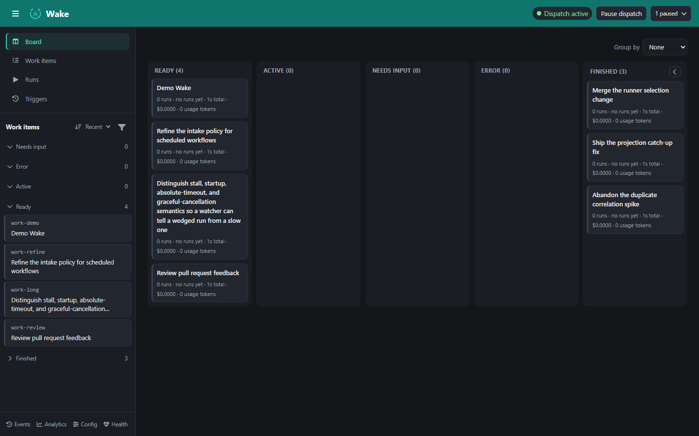
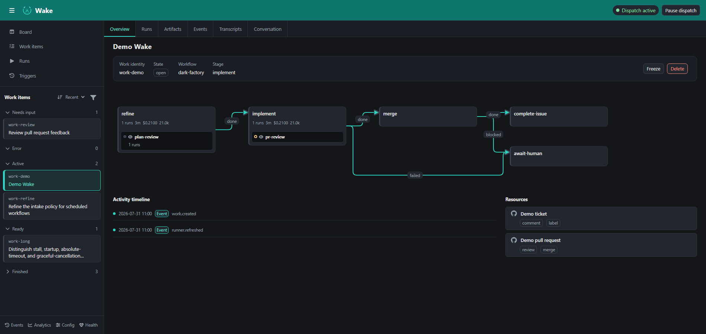

# Web UI

Wake's web UI gives operators a view of work, runs, workflows, and system health.
The screenshots below use example data.
Start it with `wake ui`, then open the address it prints. To sign in, run
`wake ui token` and use the temporary pairing link or code. See
[getting started](getting-started.md) for setup and [public UI access](public-ui-access.md)
if you need to reach it from another device.

The sidebar links to the main screens and groups work items by status. Search
for a work item by title or resource ID, sort the list, and select an item to
open its details. The header also provides dispatch controls.

## Board

The Board is the default view. It groups work items by their current condition,
with columns for Ready, Active, Needs input, Error, and Finished. Cards
summarize work and provide a route into its details.

A work item whose workflow is waiting on delegated child work items is shown
as Active with a "waiting on children: N/M finished" badge rather than as
needing input. Its own delegating run outcome is not shown while it waits,
because Wake holds that outcome until the children settle. It moves to Needs
input only when a child is blocked (shown as a "child blocked" badge) or the
parent has escalated a question about its children to a human. Once the
children's results are joined, the card goes back to the normal conditions.

## Work items

The Work items page lists work across the system. Open an item to inspect its
status, workflow, activity, and linked resources such as issues and pull requests.
The detail page brings related information together in tabs:

- **Overview** shows the current workflow, activity timeline, resources, and
  available actions. It also explains when a merge is waiting for human action.
- **Runs** lists activity attempts for the item and links to run details.
- **Artifacts** lists accepted outputs from workflow stages. Markdown files can
  be viewed in the browser; files can also be downloaded.
- **Events** shows the item's recorded events.
- **Transcripts** shows captured agent conversations.
- **Conversation** shows the work item's discussion across its sources. When
  messaging is enabled, an operator can send a message or, for eligible blocked
  agent work, continue with instructions.

Available actions depend on the work item's state and configured workflow.

## Runs

Runs lists activity attempts across work items. Open a run to inspect its status,
runner, timing, outcome, transcript, and any operator instructions captured for
that run. This is useful when investigating what an agent did or why an attempt
stopped.

## Triggers

Triggers shows configured automatic entry points, their workflows, status, next
scheduled time where applicable, and recent invocations. Open a trigger to see
pending requests, skipped occurrences and reasons, invocation history, and links
to the work it started.

You can pause or resume automatic triggering and request **Run now**. Pausing a
trigger does not stop an invocation already in progress; a manual run can also
be requested while it is paused. A trigger with a configured shared context
scope also offers an editor for operator standing instructions, which apply to
triggers sharing that scope. Triggers themselves are configured in Wake's
configuration files; see [configuration](configuration.md) and
[workflows](workflows.md).

## Events

Events provides a system-wide view of the durable event history. Use it to
inspect what Wake recorded as work, runs, and other activity progressed. For the
events belonging to one item, use the Events tab on that work item.

## Analytics

Analytics helps you understand activity over time. **Reports** offers selectable
time windows and reports for run outcomes, token and cost usage, and run
duration. Summary tiles and bucket tables provide detail behind the charts.
**System activity** shows today's activity counters. See the
[Analytics API reference](analytics-api.md) for metric and window definitions.

## Configuration

Configuration lets you inspect the loaded configuration, available commands,
webhooks, and workflow diagrams. Use the workflow diagrams to see configured
stages and routes. To change configuration, edit the Wake home files as described
in the [configuration reference](configuration.md).

## Health

Health brings together system checks, adapter health, runner availability, and
maintenance recovery. Use it to investigate provider or runner problems and
inspect maintenance status. Available recovery actions depend on the condition.

For development preview instructions, see [Developing Wake](development.md#development-preview-with-a-remote-api).
